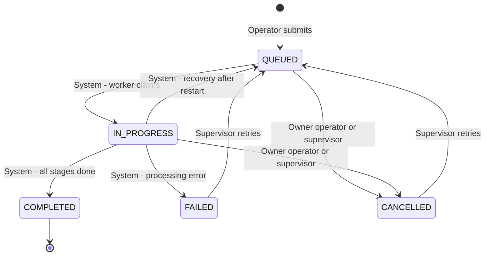

# System Analysis — Real-Time Service Request Management System

## 1. Problem Statement

A growing service organisation handles customer service requests manually. Status changes are communicated late or not at all, supervisors have no single view of what is waiting, running or stuck, and nobody can tell who changed a request and when.

The organisation needs a web-based system in which:

- **operators** submit service requests and follow their progress, and
- **supervisors** monitor all processing in real time and intervene when needed,

while long-running processing happens in the background without slowing the application down.

## 2. Business Objectives

| # | Objective | Measure of success |
|---|---|---|
| BO-1 | Make status changes visible immediately | A change is visible in every connected browser in under 1 second |
| BO-2 | Process multiple requests in parallel | N requests (configurable, default 4) run at the same time; the UI and API stay responsive |
| BO-3 | Provide a complete audit trail | Every status change is recorded with actor, time and optional note |
| BO-4 | Give supervisors one live view of the workload | Dashboard with counts per status and priority, queue depth and average processing time |
| BO-5 | Allow safe control actions | Cancel, retry, reprioritise and assign work correctly even when several people act at the same moment |

## 3. Users and Stakeholders

| User | Goals | Permissions |
|---|---|---|
| **Operator** | Submit requests; see their progress; cancel a request that is no longer needed | Create requests; list and view **own** requests; cancel own requests while queued or in progress |
| **Supervisor** | Monitor all work live; react to failures; organise ownership and urgency | List and view **all** requests; dashboard; change priority; assign to a supervisor; cancel; retry |
| **System (background worker)** | Process queued requests reliably | Moves requests through `QUEUED → IN_PROGRESS → COMPLETED / FAILED`; reports progress |
| **Administrator / DevOps** | Deploy and keep the system healthy | Deploys containers, configures environment, monitors the health endpoint and logs |

## 4. Assumptions

1. Requests are processed automatically on submission; the "long-running operation" is a simulated 3-stage job (6–15 s total by default) with a configurable random failure rate.
2. Two roles only (Operator, Supervisor); users are seeded — no self-registration or forgotten-password reset. Signed-in users can change their own password.
3. Assignment is to supervisors (acting as the responsible owner); there is no separate technician role.
4. Failed processing is not retried automatically; retry is a supervisor decision (keeps the audit trail meaningful). Only infrastructure errors that stop a job before it starts processing (for example, a brief database outage) are retried by the queue, up to 3 attempts with backoff.
5. A request in progress can be cancelled; the worker stops at its next progress tick (≤ ~1.25 s).
6. A session uses a short-lived JWT access token (15 min) and a rotating refresh token in an httpOnly cookie, valid for 7 days of inactivity and at most 30 days after login. Logging out revokes the session on the server immediately.
7. Single API instance on the free cloud tier; the design documents how to scale horizontally.
8. The emphasis is on backend robustness; the web UI is intentionally functional rather than heavily styled.
9. All timestamps are stored in UTC; the UI displays local time.
10. The frontend and API run on different sites (Vercel, Render), so the refresh cookie is a cross-site cookie. Browsers that block third-party cookies (Safari by default, Chrome private windows, Brave) cannot renew a session silently; there, users sign in again after a reload or when the access token expires.

## 5. Scope

**In scope**

- Authentication with email/password and two roles (Operator, Supervisor); refresh-token sessions, server-side logout (this device or all devices) and password change
- Request submission, listing, details, status history, search, filtering, sorting and pagination
- Background processing with a configurable number of concurrent workers and live progress
- Cancel, retry, priority change and assignment, with conflict detection
- Real-time updates pushed to browsers over WebSockets (Socket.IO)
- Supervisor dashboard with cached statistics
- Recovery of interrupted processing after a restart
- Health endpoint, structured logging, Docker setup, cloud deployment
- Automated backend tests

**Out of scope**

Self-registration, forgotten-password reset (needs email delivery), email/SMS notifications, file attachments, SLA timers, multi-tenancy, CI/CD pipeline, native mobile apps, internationalisation.

## 6. Functional Requirements

| ID | Requirement | Actor | Priority |
|---|---|---|---|
| FR-01 | Users log in with email and password and receive a short-lived access token and a refresh session | Operator, Supervisor | Must |
| FR-02 | The system enforces role-based permissions (Operator, Supervisor) | System | Must |
| FR-03 | An operator creates a service request with title, description, category and priority | Operator | Must |
| FR-04 | A new request is queued and processed automatically in the background | System | Must |
| FR-05 | Users view a paginated list of requests (operators: own; supervisors: all) | Operator, Supervisor | Must |
| FR-06 | Users search (text, reference number) and filter by status, priority, category, assignee, creator and date range, with sorting | Operator, Supervisor | Must |
| FR-07 | Users view request details including live progress, current stage, attempts and failure reason | Operator, Supervisor | Must |
| FR-08 | Users view the status history (timeline) of a request with who and when | Operator, Supervisor | Must |
| FR-09 | Lists, details and dashboard update automatically when data changes (server push) | Operator, Supervisor | Must |
| FR-10 | Processing progress (percentage and stage) is shown live | Operator, Supervisor | Must |
| FR-11 | Owner operators and supervisors cancel a queued or in-progress request | Operator, Supervisor | Must |
| FR-12 | Supervisors retry a failed or cancelled request | Supervisor | Must |
| FR-13 | Supervisors change priority and assign a request to a supervisor | Supervisor | Should |
| FR-14 | Supervisors view a dashboard: counts by status and priority, queue waiting/active, average processing time | Supervisor | Must |
| FR-15 | Multiple requests are processed concurrently up to a configurable limit | System | Must |
| FR-16 | Interrupted processing is recovered automatically after a restart | System | Should |
| FR-17 | Every status change is recorded in an audit trail with actor and optional note | System | Must |
| FR-18 | Concurrent conflicting edits are detected and rejected with a clear message | System | Must |
| FR-19 | The UI shows the real-time connection state and resynchronises after reconnecting | Operator, Supervisor | Should |
| FR-20 | The system exposes a health endpoint for operations | Administrator | Should |
| FR-21 | Sessions renew silently while in use and end after 7 days of inactivity or 30 days after login | Operator, Supervisor | Should |
| FR-22 | Users log out of the current device or of all devices; a logged-out session stops working immediately, including open WebSocket connections | Operator, Supervisor | Should |
| FR-23 | Users change their own password by confirming the current one; their other devices are signed out | Operator, Supervisor | Should |

**Mapping to the requirement examples in the brief:** create → FR-03 · view → FR-05, FR-07, FR-08 · **update request status → FR-04 (automatic transitions by the worker) + FR-11, FR-12 (cancel, retry) + FR-13 (priority, assignment)** · monitor progress → FR-10, FR-14 · receive live updates → FR-09 · cancel → FR-11 · search and filter → FR-06.

### 6.1 Request Lifecycle

| From | To | Who | Effect |
|---|---|---|---|
| — | `QUEUED` | Operator | Request stored and queued for processing |
| `QUEUED` | `IN_PROGRESS` | System | Worker claims the request; attempt counter increases |
| `IN_PROGRESS` | `COMPLETED` | System | Progress set to 100 %, finish time recorded |
| `IN_PROGRESS` | `FAILED` | System | Failure reason recorded |
| `IN_PROGRESS` | `QUEUED` | System | Only during startup recovery |
| `QUEUED`, `IN_PROGRESS` | `CANCELLED` | Owner operator or supervisor | Queued job removed; a running worker stops at its next step |
| `FAILED`, `CANCELLED` | `QUEUED` | Supervisor | Progress reset and request queued again |

Any other transition is rejected. Every transition is written to the audit trail.

### 6.2 Use Cases per Actor

**Operator**
- Log in (FR-01)
- Submit a request (FR-03, FR-04)
- Browse, search and filter own requests (FR-05, FR-06)
- Follow a request's progress and history live (FR-07, FR-08, FR-09, FR-10)
- Cancel an own request that is still queued or running (FR-11)
- Change own password; sign out of this device or of all devices (FR-21, FR-22, FR-23)

**Supervisor**
- Log in (FR-01)
- Monitor the live dashboard (FR-09, FR-14)
- Browse, search and filter all requests (FR-05, FR-06)
- Inspect any request's progress and history (FR-07, FR-08, FR-10)
- Cancel, retry, reprioritise or assign requests (FR-11, FR-12, FR-13, FR-18)
- Change own password; sign out of this device or of all devices (FR-21, FR-22, FR-23)

**System**
- Process queued requests concurrently (FR-04, FR-15)
- Record every status change (FR-17)
- Recover interrupted work after a restart (FR-16)
- Push changes to connected clients (FR-09, FR-10)

**Administrator**
- Check service health (FR-20)

## 7. Non-Functional Requirements

| ID | Category | Requirement (measurable) | Justification | How it is met |
|---|---|---|---|---|
| NFR-01 | Performance | API p95 < 300 ms for reads and writes while all workers are busy; list pages ≤ 100 items | Operators and supervisors work interactively; slow responses break the "real-time" experience | Processing runs in background workers; B-tree indexes on filter columns and trigram indexes for text search; page size capped at 100 |
| NFR-02 | Responsiveness | A status or progress change appears in connected browsers within 1 s | Core business objective BO-1 | Server push over Socket.IO immediately after each database commit; no polling |
| NFR-03 | Concurrency | N (default 4, configurable) requests processed in parallel; long-running work never blocks HTTP handling | Brief requires concurrent processing; volume grows with the organisation | BullMQ worker with configurable concurrency; the API returns as soon as a request is stored and queued |
| NFR-04 | Scalability | Stateless API and queue-based workers; a documented path to more instances | The organisation is growing | Short-lived JWT access tokens, with the session checked in the same query that loads the user (no extra round trip); jobs in Redis can be consumed by additional worker processes; Socket.IO Redis adapter as the documented next step |
| NFR-05 | Reliability | No lost or overwritten updates; no request is lost after a restart; in-progress work is recovered; graceful shutdown | Requests represent customer work and must never silently disappear | Atomic conditional database writes and optimistic locking; PostgreSQL is the source of truth for every request; Redis `noeviction` (plus append-only persistence in the Docker setup); startup recovery re-queues interrupted requests and re-enqueues queued requests whose job is missing, so a Redis restart without persistence loses no work; shutdown hooks wait for active jobs |
| NFR-06 | Security | Hashed passwords, token authentication with revocable sessions, role-based access, input whitelisting, rate limiting, security headers, CORS allow-list, no secrets in the repository, no data leakage between operators | Requests contain customer information | bcrypt, short-lived JWT plus rotating refresh tokens stored only as hashes (reuse revokes the session), httpOnly cookie with an Origin check on the cookie endpoints, global auth and role guards, validation pipe with whitelist, throttling (stricter on login), Helmet, CORS from configuration, operators receive 404 for others' requests and only their own WebSocket events |
| NFR-07 | Maintainability | Modular layered architecture, typed DTOs, versioned migrations, lint and formatting, automated tests | The system must be extended and handed over | NestJS modules with controller → service → repository layers; Prisma migrations; ESLint and Prettier; unit and end-to-end tests |
| NFR-08 | Availability | Health endpoint checking dependencies; containers with healthchecks and restart policy | Problems must be detected and recovered quickly | `/api/v1/health` checks PostgreSQL and Redis; Docker healthchecks; restart policies; platform health checks on the host |
| NFR-09 | Usability | Clear status indicators, progress bars, inline form errors, feedback for every action | Users need to understand state at a glance | Colour-coded status badges, live progress bars, field-level validation messages, toast notifications |
| NFR-10 | Responsiveness (UI) | Usable on screens from 360 px wide to desktop | Supervisors and operators may use phones or tablets | Responsive layout: tables on wide screens, cards on narrow screens |
| NFR-11 | Observability | Structured JSON logs with a request id; worker lifecycle logged; health endpoint | Problems must be traceable from a user report to the server | Pino logging with `x-request-id` correlation; worker logs for claimed, completed, failed, cancelled and recovered requests |
| NFR-12 | Data integrity | Foreign keys, enums, check constraints; audit trail written in the same transaction as the change | Status and history must never disagree | PostgreSQL constraints; each status change and its history row are written in one transaction |

## 8. Traceability of Mandatory Technical Skills

| Mandatory skill | Where it is satisfied |
|---|---|
| RESTful API development | NestJS controllers under `/api/v1` (auth, users, requests, health) — `backend/src/*/*.controller.ts` |
| Database design and integration | PostgreSQL schema and migrations in `backend/prisma/`; repository layer in `backend/src/requests/requests.repository.ts` |
| Input validation | Global validation pipe and DTO classes in `backend/src/**/dto/` |
| Error handling | Global exception filter and error codes in `backend/src/common/` |
| Layered architecture | Controller → service → repository in each module |
| Configuration management | Validated environment configuration in `backend/src/config/`; `.env.example` files |
| Responsive user interface | Next.js pages and components in `frontend/src/` |
| API integration | API client and query hooks in `frontend/src/lib/api.ts` and `frontend/src/hooks/` |
| Form validation | zod schemas with react-hook-form in `frontend/src/lib/schemas.ts` |
| State management | TanStack Query (server state) and Zustand (session, connection state) |
| Real-time UI updates | Socket.IO client hook `frontend/src/hooks/use-realtime.ts` |
| WebSocket communication | Socket.IO gateway in `backend/src/realtime/` |
| Concurrent processing | BullMQ worker in `backend/src/processing/` |
| Database relationships and constraints | Foreign keys, enums, unique and check constraints in the Prisma schema and migrations |
