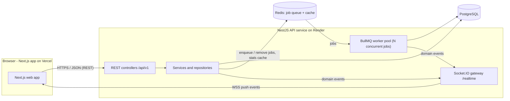
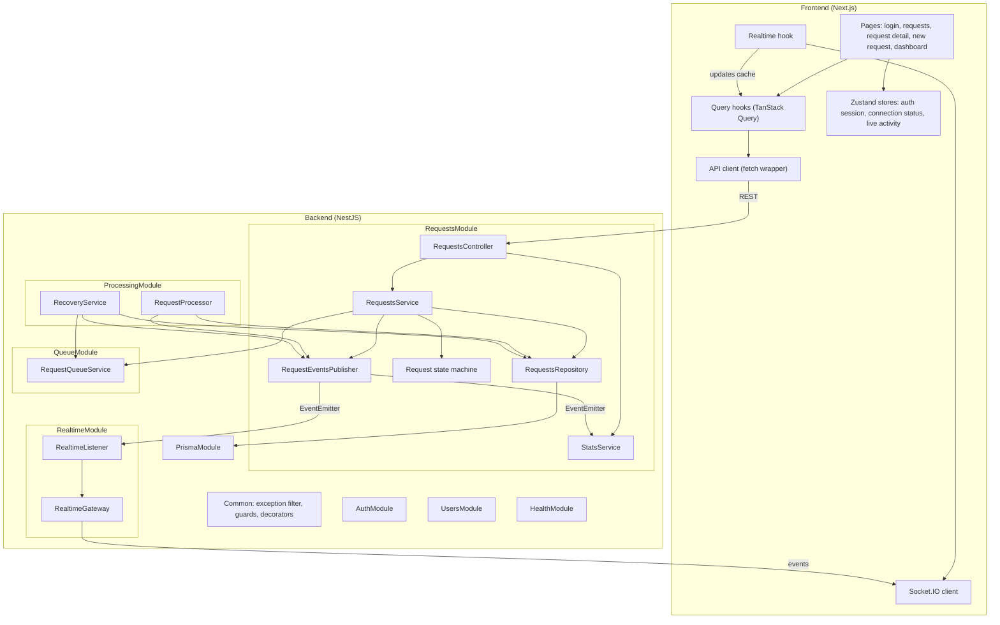
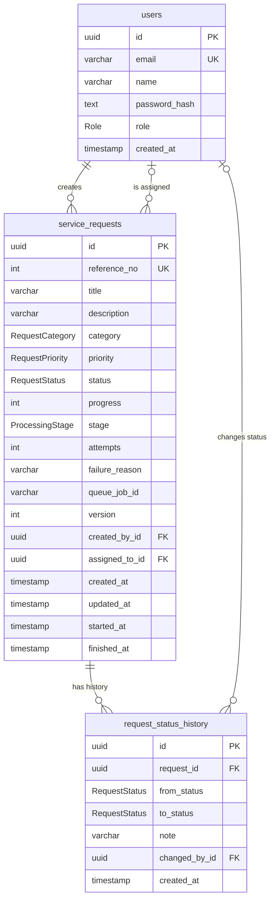
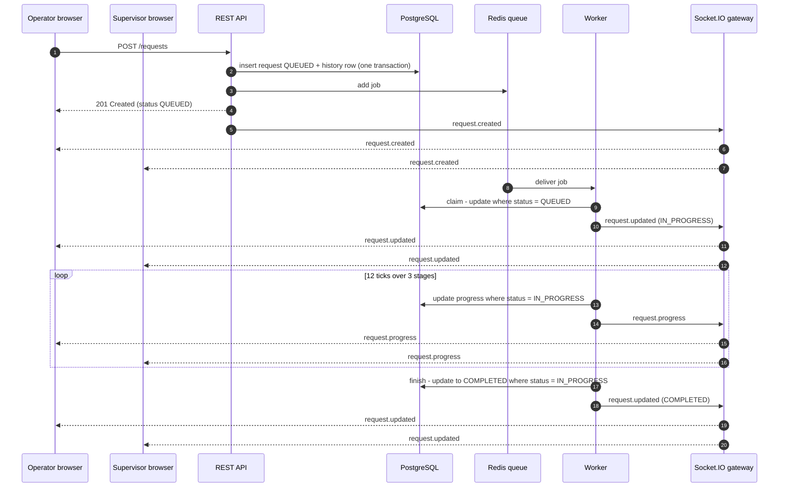
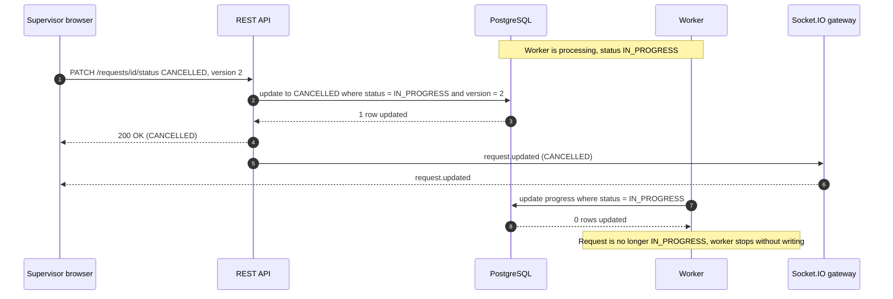
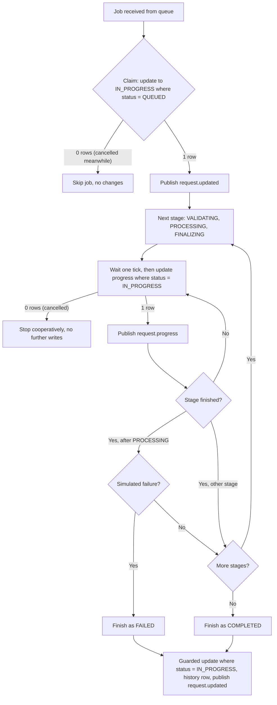
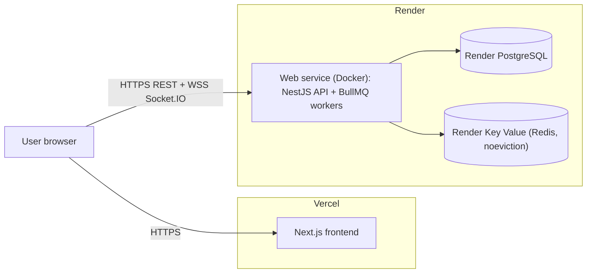

# System Design — Real-Time Service Request Management System

## 1. High-Level Architecture



**Request flow.** The browser calls the REST API to create or change a request. The API validates the input, writes the change and its audit row to PostgreSQL in one transaction, and — for new or retried requests — adds a job to the Redis-backed BullMQ queue. It answers immediately (`201`/`200`); it never waits for processing. A pool of BullMQ workers inside the API process picks up jobs (up to `WORKER_CONCURRENCY` at a time), moves each request through its processing stages and writes progress to the database. Every committed change raises an internal domain event, which the Socket.IO gateway pushes to exactly the users allowed to see that request. Browsers update their state from these events; there is no polling.

## 2. Component Design



| Module | Responsibility |
|---|---|
| Common | Unified error format (exception filter), JWT and role guards, `@Public`, `@Roles`, `@CurrentUser` decorators, pagination helpers |
| AuthModule | Login, token issuing and verification, current user |
| UsersModule | User lookup, supervisor listing, assignee validation |
| RequestsModule | Request endpoints, business rules, state machine, audit history, statistics with cache, domain event publishing |
| QueueModule | BullMQ connection and queue; enqueue, remove and inspect jobs |
| ProcessingModule | Background worker that processes requests; startup recovery of interrupted work |
| RealtimeModule | Authenticated Socket.IO gateway with rooms; forwards domain events to clients |
| PrismaModule | Database client lifecycle |
| HealthModule | Dependency health checks (PostgreSQL, Redis) |

**Dependency rule.** `RequestsModule` depends on `QueueModule`; `ProcessingModule` depends on `QueueModule` and `RequestsModule`. `RequestsModule` never depends on `ProcessingModule`, and the worker never imports the gateway — it only publishes domain events. This keeps the module graph acyclic and lets the transport (Socket.IO) change without touching business logic.

## 3. Layered Architecture

| Layer | Responsibility | Never does |
|---|---|---|
| **Controller** | HTTP routing, input validation (DTO classes), authentication and role checks, status codes, API documentation | Business rules, database access |
| **Service** | Business rules, state machine checks, version checks, orchestration (database → queue → events), mapping to response DTOs | HTTP concerns, raw queries |
| **Repository** | All Prisma queries for requests, transactions, guarded (conditional) updates, filter building | Business decisions |
| **Database** | Integrity: foreign keys, enums, unique and check constraints | — |

**DTOs vs entities.** Request bodies and query strings are validated DTO classes. Database rows (Prisma models) never leave the service layer: a mapper converts them into response DTOs (`RequestDto`, `HistoryEntryDto`), so internal fields such as `passwordHash` or `queueJobId` are never exposed and the API contract stays stable when the schema changes.

## 4. Database Design



**Enums:** `Role` (OPERATOR, SUPERVISOR) · `RequestStatus` (QUEUED, IN_PROGRESS, COMPLETED, FAILED, CANCELLED) · `RequestPriority` (LOW, MEDIUM, HIGH, URGENT) · `RequestCategory` (HARDWARE, SOFTWARE, NETWORK, ACCESS, OTHER) · `ProcessingStage` (VALIDATING, PROCESSING, FINALIZING).

### 4.1 Constraints

| Table | Constraint | Purpose |
|---|---|---|
| users | PK `id` (UUID) | Identity |
| users | UNIQUE `email` | One account per email; login lookup |
| service_requests | PK `id` (UUID) | Identity; not guessable in URLs |
| service_requests | UNIQUE `reference_no` (auto-increment) | Human-friendly reference `SR-00042` |
| service_requests | FK `created_by_id → users.id` ON DELETE RESTRICT | A request always has its creator; users with requests cannot be deleted |
| service_requests | FK `assigned_to_id → users.id` ON DELETE SET NULL | Removing an assignee leaves the request unassigned |
| service_requests | CHECK `progress BETWEEN 0 AND 100` | Progress is always a valid percentage |
| service_requests | CHECK `attempts >= 0`, CHECK `version >= 1` | Counters cannot become invalid |
| service_requests | CHECK `length(trim(title)) >= 3` | Defends the title rule at database level too |
| request_status_history | FK `request_id → service_requests.id` ON DELETE CASCADE | History lives and dies with its request |
| request_status_history | FK `changed_by_id → users.id` ON DELETE SET NULL | `NULL` means the change was made by the system |
| all | PostgreSQL enums for role, status, priority, category, stage | Invalid values are impossible |

### 4.2 Indexes

| Index | Type | Why |
|---|---|---|
| `service_requests(status)` | B-tree | Status filters, dashboard counts, recovery query |
| `service_requests(priority)` | B-tree | Priority filter and sort |
| `service_requests(created_at)` | B-tree | Default sort (newest first) and date-range filter |
| `service_requests(created_by_id)` | B-tree | Operators only see their own requests — used by every operator query |
| `service_requests(assigned_to_id)` | B-tree | Assignee filter |
| `service_requests(title)` | GIN trigram (`pg_trgm`) | Fast case-insensitive "contains" search on title |
| `service_requests(description)` | GIN trigram (`pg_trgm`) | Fast case-insensitive "contains" search on description |
| `request_status_history(request_id, created_at)` | B-tree | Timeline of one request in order |

### 4.3 Key Design Decisions

- **`version` (optimistic locking).** Incremented on every status, priority or assignment change, but **not** on progress ticks. Clients send the version they last saw; if it no longer matches, the change is rejected with `409 VERSION_CONFLICT` instead of silently overwriting someone else's edit. Progress ticks do not bump it, otherwise a user could never act on a request while a worker is running.
- **`request_status_history` (audit trail).** One row per transition with old and new status, actor and note, written in the **same transaction** as the status change, so the current status and its history can never disagree.
- **Progress stored on the request row.** The latest progress and stage are always readable via REST, so a client that (re)connects gets the correct state without replaying events.
- **CHECK constraints, the `pg_trgm` extension and the trigram indexes** are kept together in one hand-written SQL migration. Prisma's schema language cannot express CHECK constraints, and keeping the search setup next to them makes the database rules easy to review in one place.

## 5. API Design

### 5.1 Conventions

| Aspect | Convention |
|---|---|
| Base path and versioning | `/api/v1` (URI versioning) |
| Format | JSON request and response bodies; ISO-8601 UTC timestamps |
| Authentication | `Authorization: Bearer <JWT>` on every endpoint except `POST /auth/login` and `GET /health` |
| Documentation | OpenAPI / Swagger UI at `/docs` |
| Pagination | `?page=1&pageSize=20` (max 100) → `{ items, meta: { page, pageSize, total, totalPages } }` |
| Correlation | Every response carries `x-request-id`; the same id appears in server logs and error bodies |
| Status codes | `200` OK · `201` Created · `400` validation / bad request · `401` not authenticated · `403` not allowed · `404` not found (also for other operators' requests) · `409` invalid transition / version conflict · `429` rate limited · `500` unexpected error · `503` dependency down (health) |

**Error format** (every error response):

```json
{
  "statusCode": 409,
  "code": "VERSION_CONFLICT",
  "message": "The request was modified by someone else. Reload and try again.",
  "details": null,
  "path": "/api/v1/requests/…/status",
  "timestamp": "2026-10-27T10:00:00.000Z",
  "requestId": "b2c1…"
}
```

Error codes: `VALIDATION_ERROR` (400, `details` lists `{ field, messages[] }`), `BAD_REQUEST` (400), `UNAUTHORIZED` (401), `INVALID_CREDENTIALS` (401), `FORBIDDEN` (403), `NOT_FOUND` (404), `INVALID_TRANSITION` (409), `VERSION_CONFLICT` (409), `CONFLICT` (409), `RATE_LIMITED` (429), `SERVICE_UNAVAILABLE` (503, health check only; `details` names the failing dependency), `INTERNAL_ERROR` (500 — never exposes internal details).

### 5.2 Endpoints

| Method | Path | Roles | Body / Query | Success |
|---|---|---|---|---|
| GET | `/health` | public | — | 200 `{ status: 'ok', info: { database, redis } }`; 503 if a dependency is down |
| POST | `/auth/login` | public, 5 attempts/min per IP | `{ email, password }` | 200 `{ accessToken, user }` |
| GET | `/auth/me` | any | — | 200 `UserDto` |
| GET | `/users` | SUPERVISOR | `?role=SUPERVISOR\|OPERATOR` | 200 `UserDto[]` |
| POST | `/requests` | OPERATOR | `CreateRequestDto` | 201 `RequestDto` (status `QUEUED`) |
| GET | `/requests` | any | `ListRequestsQuery` | 200 `Paginated<RequestDto>` — operators see only their own |
| GET | `/requests/stats` | SUPERVISOR | — | 200 `StatsDto` (cached) |
| GET | `/requests/:id` | any | — | 200 `RequestDto`; an operator who is not the owner gets 404 |
| GET | `/requests/:id/history` | any | — | 200 `HistoryEntryDto[]` (oldest first); same visibility rule |
| PATCH | `/requests/:id` | SUPERVISOR | `UpdateRequestDto` | 200 `RequestDto` |
| PATCH | `/requests/:id/status` | OPERATOR (cancel own only), SUPERVISOR | `ChangeStatusDto` | 200 `RequestDto` |

### 5.3 Validation Rules

| DTO | Field | Rule |
|---|---|---|
| CreateRequestDto | `title` | string, trimmed, 3–120 characters |
| | `description` | string, trimmed, 10–2000 characters |
| | `category` | `HARDWARE \| SOFTWARE \| NETWORK \| ACCESS \| OTHER` |
| | `priority` | optional `LOW \| MEDIUM \| HIGH \| URGENT`, default `MEDIUM` |
| UpdateRequestDto | `priority` | optional enum |
| | `assignedToId` | optional UUID of a **supervisor**, or `null` to unassign |
| | `version` | required integer ≥ 1 (at least one of `priority` / `assignedToId` must be present) |
| ChangeStatusDto | `status` | `CANCELLED` or `QUEUED` (retry); system-only statuses are rejected |
| | `note` | optional, ≤ 500 characters |
| | `version` | required integer ≥ 1 |
| ListRequestsQuery | `q` | optional, ≤ 100 characters; matches title or description (case-insensitive), or the reference number (`42`, `SR-00042`) |
| | `status`, `priority` | optional comma-separated lists of enum values |
| | `category` | optional enum |
| | `assignedToId`, `createdById` | optional UUID (`assignedToId` also accepts `unassigned`); supervisors only |
| | `createdFrom`, `createdTo` | optional ISO dates, inclusive; `createdFrom` must not be after `createdTo` |
| | `sortBy` / `sortOrder` | `createdAt` (default), `updatedAt`, `priority`, `referenceNo` / `desc` (default), `asc` |
| | `page` / `pageSize` | integer ≥ 1 (default 1) / 1–100 (default 20) |

Unknown fields are rejected (`whitelist` + `forbidNonWhitelisted`), which prevents clients from setting fields such as `status` or `createdById` directly.

### 5.4 Examples

**Login**

```http
POST /api/v1/auth/login
Content-Type: application/json

{ "email": "operator1@demo.test", "password": "Password123!" }
```
```json
200 OK
{
  "accessToken": "eyJhbGciOiJIUzI1NiIs…",
  "user": { "id": "5b0e…", "email": "operator1@demo.test", "name": "Olivia Operator", "role": "OPERATOR" }
}
```

**Create a request**

```http
POST /api/v1/requests
Authorization: Bearer eyJ…

{ "title": "Laptop does not boot", "description": "Black screen after the latest update.", "category": "HARDWARE", "priority": "HIGH" }
```
```json
201 Created
{
  "id": "8f3c…", "referenceNo": 42, "title": "Laptop does not boot",
  "description": "Black screen after the latest update.", "category": "HARDWARE", "priority": "HIGH",
  "status": "QUEUED", "progress": 0, "stage": null, "attempts": 0, "failureReason": null, "version": 1,
  "createdBy": { "id": "5b0e…", "name": "Olivia Operator" }, "assignedTo": null,
  "createdAt": "2026-10-27T10:00:00.000Z", "updatedAt": "2026-10-27T10:00:00.000Z",
  "startedAt": null, "finishedAt": null
}
```

**List with filters**

```http
GET /api/v1/requests?q=laptop&status=QUEUED,IN_PROGRESS&priority=HIGH,URGENT&sortBy=priority&sortOrder=desc&page=1&pageSize=20
```
```json
200 OK
{ "items": [ { "id": "8f3c…", "referenceNo": 42, "status": "IN_PROGRESS", "progress": 33, "…": "…" } ],
  "meta": { "page": 1, "pageSize": 20, "total": 1, "totalPages": 1 } }
```

**Change status — success and conflict**

```http
PATCH /api/v1/requests/8f3c…/status

{ "status": "CANCELLED", "note": "Duplicate of SR-00041", "version": 3 }
```
```json
200 OK
{ "id": "8f3c…", "status": "CANCELLED", "version": 4, "finishedAt": "2026-10-27T10:00:07.000Z", "…": "…" }
```
Sending the same body again (version 3 is now outdated):
```json
409 Conflict
{ "statusCode": 409, "code": "VERSION_CONFLICT",
  "message": "The request was modified by someone else. Reload and try again.",
  "details": null, "path": "/api/v1/requests/8f3c…/status",
  "timestamp": "2026-10-27T10:00:08.000Z", "requestId": "c71d…" }
```

## 6. WebSocket Communication

| Aspect | Design |
|---|---|
| Library / namespace | Socket.IO, namespace `/realtime` on the API host; same origin allow-list as REST, also checked during the handshake because browsers do not apply CORS to WebSocket upgrades |
| Authentication | Client connects with `auth: { token: '<JWT>' }`; the server verifies it during the handshake. Invalid or missing token → server emits `error { code: 'UNAUTHORIZED' }` and disconnects |
| Rooms | Every socket joins `user:{userId}`; supervisors also join `role:SUPERVISOR` |
| Routing rule | Each request event goes to `role:SUPERVISOR` + `user:{createdById}` (+ `user:{assignedToId}` if assigned) in a single emit (Socket.IO de-duplicates sockets in several rooms) |
| Ordering | Events are emitted only **after** the database transaction commits |
| Direction | Server → client only; all commands go through REST |

| Event | Payload | When |
|---|---|---|
| `request.created` | `{ request: RequestDto }` | After a request is created |
| `request.updated` | `{ request: RequestDto }` | Any status, priority or assignment change (by worker or user) |
| `request.progress` | `{ id, referenceNo, status, progress, stage, updatedAt }` | Every worker progress tick |

### 6.1 Request Processing Flow



### 6.2 Cancel While In Progress



### 6.3 Reconnection and Why There Is No Polling

- Socket.IO reconnects automatically with back-off. On every (re)connect the client re-fetches the data currently on screen **once** over REST, then continues on pushed events. This closes any gap while offline without periodic requests.
- The UI shows the connection state (Live / Connecting / Offline).
- Polling was rejected: it adds latency equal to the polling interval, multiplies load with the number of open browsers, and transfers unchanged data. Push sends only what changed, to whom it concerns, when it changes. Progress events are small deltas, not full objects.

## 7. Concurrency Model

### 7.1 Execution Model

- **Event loop.** Node.js runs JavaScript on one thread but performs I/O asynchronously. The simulated processing consists of timed waits and database writes; while a job waits, the event loop serves HTTP requests and other jobs. One process can therefore run several jobs at the same time without blocking the API.
- **Worker pool.** A BullMQ worker with concurrency `WORKER_CONCURRENCY` (default 4) runs inside the API process. At most N requests are `IN_PROGRESS` at once; further jobs wait in the Redis queue (`QUEUED`).
- **Non-blocking API.** Creating or retrying a request only writes to the database and adds a job; the response is returned immediately.
- **CPU-heavy work (not needed here).** If real CPU-bound processing were added, it would run in BullMQ sandboxed processors or worker threads so it cannot block the event loop.

### 7.2 Job Lifecycle



Each stage lasts a random time between `JOB_STAGE_MIN_MS` and `JOB_STAGE_MAX_MS` and is split into 4 ticks, so a request reports 12 progress updates. Progress is capped at 99 % until completion sets it to 100 %.

### 7.3 Race Conditions and Mitigations

| # | Race condition | What could go wrong | Mitigation |
|---|---|---|---|
| 1 | Two workers receive the same request | Processed twice | **Atomic claim**: `UPDATE … SET status = 'IN_PROGRESS' WHERE id = ? AND status = 'QUEUED'`. Only one update can match; the other sees 0 rows and exits |
| 2 | User cancels while the worker is writing progress | Worker overwrites `CANCELLED` | **Guarded worker writes**: every worker update includes `WHERE status = 'IN_PROGRESS'`. After a cancel it matches 0 rows and the worker stops (cooperative cancellation, at most one tick later) |
| 3 | Cancel and completion at the same moment | Both succeed, inconsistent state | Both are conditional updates on the same row; the database serialises them, the first one wins and the second matches 0 rows. A cancel that wins is never overwritten; a completion that wins makes the cancel return `409 INVALID_TRANSITION` |
| 4 | Two supervisors edit the same request | Lost update | **Optimistic locking**: updates include `WHERE version = <client version>` and increment `version`; the slower edit gets `409 VERSION_CONFLICT` and reloads |
| 5 | The same request is enqueued twice (retried call, recovery) | Duplicate processing | Deterministic **job id** `{requestId}-v{version}` — BullMQ ignores a job whose id already exists; the atomic claim (1) is the second line of defence |
| 6 | Server crashes mid-processing | Request stuck in `IN_PROGRESS` forever | **Startup recovery**: `IN_PROGRESS` requests are reset to `QUEUED` with a history note and re-enqueued; `QUEUED` requests without a job are re-enqueued |

Additional ordering rule: the database change is **committed before** a job is enqueued. Enqueuing first could let a worker try to claim a request that is not yet visible as `QUEUED`, losing the job. If enqueuing fails after the commit, the error is logged and startup recovery re-enqueues the request.

### 7.4 Configuration

| Variable | Default | Effect |
|---|---|---|
| `WORKER_CONCURRENCY` | 4 | Maximum requests processed at the same time |
| `JOB_STAGE_MIN_MS` / `JOB_STAGE_MAX_MS` | 2000 / 5000 | Duration range of each of the 3 stages |
| `JOB_FAILURE_RATE` | 0.1 | Probability that a request fails after the processing stage |

### 7.5 Scaling Path

- Run additional worker-only processes on other machines against the same Redis queue; the atomic claim keeps processing exactly-once per attempt.
- Run several API instances behind a load balancer; authentication is stateless (JWT).
- Add the Socket.IO Redis adapter so an event emitted on one instance reaches sockets connected to another.

## 8. Technology Stack Justification

| Layer | Choice | Why | Alternatives considered |
|---|---|---|---|
| Backend framework | **NestJS** (TypeScript) | Modules and dependency injection enforce the layered architecture; decorators for validation, guards and roles; first-class WebSocket and BullMQ integrations; built-in OpenAPI support | Express / Fastify — more wiring and fewer conventions for the same result |
| Database | **PostgreSQL 16** | Relational integrity (foreign keys, enums, check constraints), transactions for status + history, trigram indexes for text search | MongoDB — weaker relational constraints and multi-document transactional guarantees for this data |
| ORM | **Prisma** | Type-safe client built from the schema, versioned migrations, easy conditional `updateMany` for guarded writes | TypeORM — more runtime magic, weaker type safety |
| Queue / workers | **BullMQ + Redis** | Durable jobs that survive restarts, configurable concurrency, job ids for de-duplication; Redis also serves the statistics cache | In-memory queue — jobs lost on restart, no path to multiple processes |
| Real-time | **Socket.IO** | Rooms for per-user / per-role delivery, handshake authentication, automatic reconnection, fallback transport | Raw `ws` — rooms and reconnection built by hand; Server-Sent Events — no rooms, no handshake authentication, and reconnection and resync handled by hand |
| Frontend | **Next.js + React** | Mature React framework, simple file-based routing, straightforward deployment on Vercel | Plain React with Vite — equally possible; Next.js chosen for routing and hosting convenience |
| Frontend state | **TanStack Query + Zustand** | TanStack Query caches server state and is updated directly from socket events; Zustand holds the small client state (session, connection) with minimal code | Redux Toolkit — more boilerplate for the same needs |
| UI components | **shadcn/ui + Tailwind CSS** | Accessible components (built on Radix primitives) copied into the repo, so they are owned code rather than a runtime dependency; consistent look without custom design work | Material UI — heavier runtime library and harder to restyle |
| Forms | **react-hook-form + zod** | Declarative validation mirroring the backend rules; server validation errors mapped to fields | Manual validation |
| Packaging | **Docker / Docker Compose** | Identical environments for development and deployment; one command to start PostgreSQL and Redis | Local installs — inconsistent across machines |
| Hosting | **Render** (API, PostgreSQL, Redis) + **Vercel** (frontend) | Render runs a long-lived container, needed for WebSockets and background workers; Vercel is the natural host for Next.js | Serverless-only hosting — cannot keep WebSocket connections or run workers |

## 9. Security Design

### 9.1 Authentication and Authorisation

1. The user logs in with email and password. The password is checked against a bcrypt hash. Unknown email and wrong password return the same `401 INVALID_CREDENTIALS` (no user enumeration). Login is limited to 5 attempts per minute per IP.
2. The API issues a signed JWT (HS256, 8 h) containing the user id and role.
3. A **global** authentication guard protects every endpoint; only endpoints explicitly marked public (`login`, `health`) skip it (secure by default). The token's user is reloaded on each request, so a removed user loses access immediately.
4. A role guard checks `@Roles(...)` on supervisor-only endpoints.
5. Ownership rules are enforced in the service layer: operators only ever see their own requests (404 for others) and can only cancel their own.
6. The WebSocket handshake verifies the same JWT; room membership ensures operators receive events only for their own requests.

### 9.2 Permission Matrix

| Endpoint | Operator | Supervisor |
|---|---|---|
| `POST /auth/login`, `GET /health` | ✓ (public) | ✓ (public) |
| `GET /auth/me` | ✓ | ✓ |
| `GET /users` | ✗ | ✓ |
| `POST /requests` | ✓ | ✗ |
| `GET /requests`, `GET /requests/:id`, `GET /requests/:id/history` | own only | all |
| `GET /requests/stats` | ✗ | ✓ |
| `PATCH /requests/:id` (priority, assignment) | ✗ | ✓ |
| `PATCH /requests/:id/status` → `CANCELLED` | own only | ✓ |
| `PATCH /requests/:id/status` → `QUEUED` (retry) | ✗ | ✓ |
| WebSocket events | own requests | all requests |

### 9.3 Token Storage

The frontend (Vercel) and API (Render) run on different domains, which makes cross-site cookies fragile (third-party cookie restrictions, `SameSite` rules). The access token is therefore sent as a Bearer header and kept in the browser's local storage. The trade-off is exposure to cross-site scripting; it is mitigated by React's output escaping and no use of raw HTML injection. HttpOnly cookies on a shared domain plus refresh tokens are the documented improvement.

### 9.4 Threats and Mitigations

- **Brute-force login** → rate limiting (5/min/IP on login, 120/min/IP globally), bcrypt hashing.
- **Mass assignment** (client sets `status`, `createdById`, …) → DTO whitelisting rejects unknown fields.
- **Data leakage between operators** → ownership checks in services (404), per-user WebSocket rooms.
- **Injection** → parameterised queries through the ORM; validated and typed inputs.
- **Information disclosure in errors** → unified error filter; unexpected errors return a generic message, details only in server logs.
- **Cross-origin abuse** → CORS allow-list from configuration for REST and WebSockets.
- **Common web attacks** → security headers via Helmet.
- **Secrets in code** → all secrets come from environment variables; only `.env.example` files are committed.

## 10. Deployment View



- **Production.** The frontend is served by Vercel. The API runs as a Docker container on Render; on start it applies pending database migrations and then serves REST, WebSockets and the worker pool. PostgreSQL and Redis are managed Render services on the same private network. Redis uses the `noeviction` policy because BullMQ stores jobs as keys that must never be evicted.
- **Local development.** `backend/docker-compose.yml` starts PostgreSQL and Redis (and optionally the API); the frontend has its own Dockerfile and Compose file. Each folder can also run directly with Node.js.
